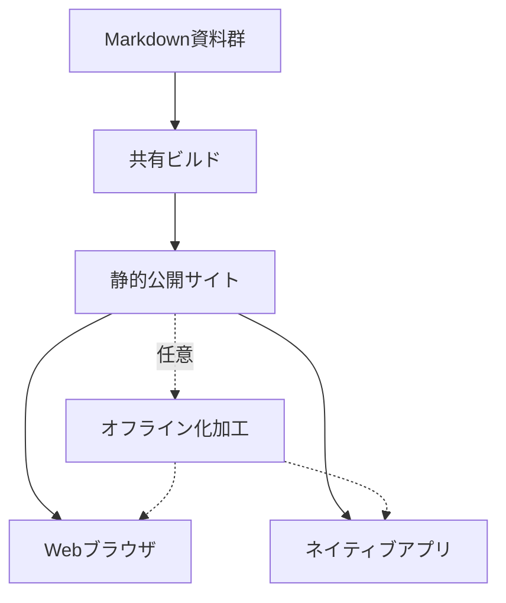

# Slidev Lab 現在の仕様

## Webライブラリと共有ビルド

Slidev Lab は、独立した複数の Markdown スライド資料を単一の静的 Web サイトとして統合し、同一の成果物を Web ブラウザでの一覧・閲覧と Rust/Tauri 2 によるネイティブアプリケーションでの発表の双方で活用できるようにする概念実証（PoC）環境です。

従来、Slidev で複数のスライド資料を公開する場合、資料ごとに個別の静的サイトをビルドするか、手作業で複数の Markdown ファイルを連結する必要がありました。しかし、個別ビルドを繰り返すと、Vue や Slidev の共通ランタイム、テーマのスタイルやアセットが資料の数だけ重複して出力され、配信容量が著しく増大します。一方で、Markdown ファイルを単純に結合する方式では、各資料が持つ独立したフロントマターや設定情報が混ざり合い、資料ごとの独立性を維持できないという課題がありました。

この課題を解決するため、本リポジトリでは個別の Markdown 記述をそのまま保ちながら、URL に応じて対象資料のモジュールを動的に読み込み、基盤となるランタイムやテーマを共有してビルドする方式を採用しています。生成される成果物は純粋な静的ファイル群で構成され、Web 配信にあたって動的なアプリケーションバックエンドを配置する必要はありません。なお、本実装は閲覧と発表の検証を目的とした PoC であり、ブラウザ上でのスライド編集を行う CMS 機能、クラウド同期基盤、あるいは一般配布向けの完成品アプリケーションではない点に留意する必要があります。



### 技術基盤と実装言語の境界

リポジトリルートの [`package.json`](package.json) では、パッケージマネージャーとして `pnpm` 12.3.4 を指定し、基盤ライブラリとして `Vue` 3.5.43、`TypeScript` 6.0.3、型検査器として `vue-tsc` 3.3.12 を採用しています。2026-10-09 時点の作業ツリーには、直前実装の未コミット変更を含んで構成されています。

Web 側のホーム画面実装では保守性と型安全性を担保するために TypeScript を導入しており、画面コンポーネントである [`frontend/Home.vue`](frontend/Home.vue) は `<script setup lang="ts">` で記述されています。フロントエンド関連のロジックは [`frontend/home.ts`](frontend/home.ts)、[`frontend/navigation.ts`](frontend/navigation.ts)、[`frontend/startup-error.ts`](frontend/startup-error.ts)、[`frontend/catalog.ts`](frontend/catalog.ts) に分割して整理されています。

ただし、この Vue 画面周辺の型定義移行はリポジトリ全体の TypeScript 化を意図したものではありません。ネイティブアプリケーションの UI・iframe 制御・注入 bridge・実機 QA は TypeScript で記述し、Cargo の desktop ビルド時に型チェックと JavaScript 生成を実行します。Node.js の各種ビルドスクリプトは JavaScript、ネイティブのコアロジックは Rust です。このように、コンテキストごとに適した言語仕様を選択して運用しています。実装の詳細は [`frontend/README.md`](frontend/README.md)、[`frontend/results/library.md`](frontend/results/library.md)、[`frontend/results/typescript.md`](frontend/results/typescript.md) を参照してください。

### 資料の探索規則とメタデータの制限

ビルド時にスライド資料を自動検出するための探索ルートは、既定で `bundle-sharing/fixtures`（`fixturesRoot`）に設定されています。ビルダーはこのディレクトリ配下を再帰的に走査し、対象となる Markdown ファイルを探索します。

探索と資料識別子（ID）の決定には以下の規則が適用されます。

- **ファイル配置と ID 解決**: `aaa/aaa1/slides.md` または `aaa/aaa1.md` という配置のファイルが検出された場合、資料 ID は `aaa/aaa1` となり、カテゴリパス（`categoryPath`）は `["aaa"]` として解決されます。
- **カテゴリ階層の抽出**: ディレクトリの入れ子構造がそのままカテゴリ階層として扱われます。走査中に同一の資料 ID が重複して検出された場合は、曖昧さを排除するためビルド処理は即座に失敗します。
- **除外対象**: `README`、`AGENTS`、ドットで始まる隠しディレクトリ、`assets`、`public`、`node_modules` は探索対象から明示的に除外されます。
- **資料件数の扱い**: 既定環境では検証用に 4 件の資料が配置されていますが、これはテスト用の初期構成であり、システムとして 4 件を固定の上限値としているわけではありません。

検出された Markdown のフロントマターからは、外部公開を意図した項目のみが厳格なホワイトリストに基づいて抽出されます。許可されている項目は `title`、`subtitle`、`author`、`date`、`description`、`tags` に限定されます。抽出結果をもとに生成される `catalog.json` は以下の主要構造を持ちます。

- `catalog.categories`: カテゴリ階層の構造定義であり、各要素は `id`、`name`、`path`、`parentId` を保持します。
- `catalog.decks`: 検出された各資料の情報であり、各要素は `id`、`title`、`entry`、`pages`、`revision`、`categoryPath`、`frontmatter`、`thumbnail`、`runtimeVersion`、`theme`、`profile` を格納します。

各資料の一覧表示で用いるサムネイル画像は、ビルド時に Chromium をヘッドレスモードで起動し、各資料の先頭スライド（1 ページ目）を 1200x675 ピクセルの解像度で実際に描画して PNG 形式（`thumbnails/<ID>.png`）として生成されます。実行バイナリは環境変数 `CHROMIUM_EXECUTABLE` で指定可能であり、本作業環境では `/usr/bin/google-chrome` が使用されます。

### Web インターフェースと画面遷移

静的サイトのルート（`/`）にアクセスすると、Vue で構築されたホーム画面が表示されます。

ホーム画面にはカテゴリ一覧と各資料のサムネイルカードが配置されます。カテゴリを選択すると、その配下に含まれる子カテゴリの資料も含めて一覧が絞り込まれます。各カードにはタイトル、サブタイトル、著者、作成日、タグ一覧、総ページ数が表示されます。サブタイトルが未設定の場合は、代替として `description` の内容が表示されます。なお、現行の実装にはキーワード検索機能や資料の管理画面は存在せず、一覧の絞り込みと選択閲覧のみが提供されます。

ホーム画面のデザインや構成を変更する場合は、[`frontend/Home.vue`](frontend/Home.vue) および [`frontend/style.css`](frontend/style.css) を編集して差し替えることが可能です。ホーム画面コンポーネントは、ビルド時に生成された `catalog.json` のデータをプロパティ（prop）として受け取る設計となっています。また、多数のカードが並んだ場合でも初期描画の負荷を抑えるため、ブラウザホームに配置されるサムネイル画像（`img` 要素）には遅延読み込み（`loading="lazy"`）が指定されています。

スライド資料への移動とページ送りは、役割に応じて以下のように明確に分離されています。

- **URL 体系**: 各資料の開始エントリは `/<deckId>/1` であり、個別スライドは `/<deckId>/<page>` で表現されます。
- **ナビゲーションの分離**: ホーム画面からスライド資料への移動、および異なるスライド資料間の切り替えは、ブラウザの通常文書ナビゲーション（フルリロードを伴う遷移）として実行されます。一方、同一資料内での前後のページ送りは、Slidev が内蔵するルーターによってクライアントサイドで高速に処理されます。通常の Web 閲覧時における Slidev 本来のキーボードショートカット操作は維持されます。
- **ホーム復帰リンクの制御**: 通常の Web 閲覧時、画面の左上にはホーム画面（`/`）へ戻るためのリンクが常設されます。また、本リポジトリ既定の `watabegg` テーマでは、操作パネル内にも `themeConfig.watabegg.navigation` 設定を通じてホームリンクが表示されます。ただし、これは当該テーマ固有の実装であり、他の任意のテーマが持つ操作パネルにまで自動的にホームリンクが挿入される保証はありません。
- **埋め込み環境での抑制**: `iframe` 内での表示、URL パラメータに `embedded=true` が指定されている場合、あるいはサムネイル描画時においては、ホスト側の UI 操作を優先するため左上のホームリンクは非表示となります。

### 共有ビルド機構とマルチプロファイル分離

複数の資料を単一の Web サイトとして統合するにあたり、本実装では Markdown ファイル自体を 1 つに連結する方式は採用していません。資料ごとの独立した設定（`configs`）とスライド内容（`slides`）を URL に応じて動的にインポート（dynamic import）し、共通のランタイムモジュールとテーマを共有する設計を採用しています。

#### 初期化ブートストラップ方式の選定理由

複数のスライドを同一ランタイム上で動的に切り替えるにあたり、初期の構想ではトップレベル await を用いたブートストラップが検討されました。しかし、検証の過程において、WebKitGTK 環境でスライドをめくった際に 3 ページ目で描画が停止し進行不能となる障害が確認されました。このため、現行の実装では非同期のトップレベル await に依存せず、確実な初期化順序を保つ同期ブートストラップ方式を採用しています。

なお、この共有ビルド機構は Slidev 内部のプラグイン構造や仮想モジュール（virtual module）の挙動に依存しています。そのため、Slidev 側の未知のバージョン差異や内部パッチの不整合を検出した場合は、予期せぬ不具合を防ぐためにビルド処理を安全に停止する設計となっています。

#### マルチプロファイルによる文書隔離

すべての資料が同一の Slidev バージョンやテーマ設定で動作するとは限りません。互換性のない資料を単一のランタイムに混在させると、コンパイルエラーやスタイルの衝突が発生します。これを解決するため、設定ファイルによって各資料 ID を「プロファイル」に割り当て、互換性のあるグループごとにビルドを分離するマルチプロファイル機構を導入しています。

各プロファイルには、依存関係の解決起点となる `dependencyRoot` と適用する `theme` が定義されます。資料同士が同一のモジュールグラフを共有してビルドされるのは、以下の条件がすべて完全に一致する場合に限定されます。

- Slidev CLI とクライアントランタイムの正確なバージョンの組み合わせ
- テーマの内容
- セットアップルート（setup roots）
- コンパイル設定

これらが異なる資料グループは、独立したビルドプロセスとして実行され、成果物は `/_profiles/<group>/` 配下の独立したディレクトリへ文書レベルで隔離されて配置されます。テーマを追加するたびにすべてのテーマを 1 つの巨大なランタイムへ混在させる方式は採用しておらず、異なるプロファイルグループ間をまたいでモジュールが共通化されることもありません。

なお、プロファイルは資料（deck）単位で割り当てるものであり、1 つの資料の内部でページごとに別々のテーマや Slidev バージョンを設定する機能ではありません。

#### 互換性の検証実績と拡張機能の制約

マルチプロファイルの検証においては、Slidev `52.15.2` および `53.0.0`、合成テーマ A および B を用いた、計 8 資料 4 グループの構成で動作が確認されています。既定のテーマには `/home/watabegg/slidev-watabegg` を無変更のまま参照しており、既定の Slidev バージョンは 53 が使用されます。

この共有ビルド環境では、テーマが提供するコンポーネント（`components`）、レイアウト（`layouts`）、セットアップ（`setup`）は正常に機能します。しかし、ビルドの安全性を担保するため、個別の資料固有に配置された `setup`、`components`、`layouts`、`styles`、ならびに資料独自の Vite 設定、UnoCSS 設定、アドオン（addons）の利用はマルチプロファイルの PoC において明示的に拒否されます。資料間で共有したい拡張機能がある場合は、個別資料ではなくテーマ側へ集約して実装する必要があります。

#### バンドル容量削減の実験値

モジュールグラフの共有によるファイルサイズ削減効果について、本リポジトリ内の検証実験では以下の数値が得られています（これらは特定構成における実験値であり、あらゆる資料構成における削減率を保証するものではありません）。

- **同一構成の 4 資料（単一グループ）**: 個別に 4 回ビルドした場合の合計サイズ 30,287,165 バイトに対し、共有ビルドを適用した結果は 7,626,672 バイトとなり、生のファイル容量が 74.82% 削減されました。
- **混在環境の 8 資料（4 グループ）**: 個別 8 グラフの合計と比較した場合、生サイズで 48.43%、gzip 圧縮後で 48.02% の削減を記録しました。

実験結果が示す通り、資料間で共通化できるモジュールが多いほど高い削減率が得られます。逆に、使用するテーマや互換グループの数が増加すると、グループごとに独立したランタイムが出力されるため共有率は低下し、成果物全体の容量は増加する傾向にあります。詳細な計測ログと分析は [`bundle-sharing/results/module-graph.md`](bundle-sharing/results/module-graph.md) および [`bundle-sharing/experiments/multi-profile/results/experiment.md`](bundle-sharing/experiments/multi-profile/results/experiment.md) を参照してください。

### 公開成果物の構成とセキュリティ境界

ビルド完了後に出力される公開用静的成果物は、以下のファイルおよびディレクトリで構成されます。

| 成果物ファイル / ディレクトリ | 役割と格納されるデータ |
| :--- | :--- |
| `index.html` | Vue で実装されたトップポータル画面（ホーム UI）。 |
| 資料エントリ HTML / JS / CSS / 画像 | 各スライド資料を描画するための HTML、分割されたスクリプト、スタイルシート、および画像アセット。 |
| `catalog.json` | Web UI が利用する公開用のメタデータ、カテゴリ定義、サムネイル参照情報。 |
| `manifest.json` | 成果物の構成定義。共有アセットおよび資料固有アセットの一覧、ランタイムバージョン、プロファイル、テーマ、リビジョン、およびリポジトリ相対の `sourcePath` を記録。 |
| `native-player.json` | ネイティブアプリ向け検出スキーマ（schemaVersion: 1, protocolVersion: 1）。対応資料一覧（`decks`: id, revision, entry, clickTotals）および非対応資料一覧（`unsupportedDecks`: id, reason）を格納。 |
| `thumbnails/` | 各資料の 1 ページ目から生成された 1200x675 PNG 画像群。 |

#### ネイティブ連携と情報の秘匿性

ネイティブアプリケーション（Rust / Tauri 2）との連携は、ビルド時に出力される静的な `native-player.json` の検出と、スライドがネイティブ側の Webview 内に埋め込まれた際（`embedded=true` かつ `nativeProtocol=1` が有効な状態）にのみ機能する通信ブリッジを通じて行われます。

公開される成果物において、機密情報や不要なデータが外部へ露出しないよう以下の保護が施されています。

- **発表者ノートと内部情報の除去**: スライド資料の Markdown 内に含まれる HTML コメントおよび発表者ノート本文は除去されます。また、公開用の `catalog.json` や `native-player.json` には、非公開の私有ノート対応表、絶対ファイルパス、認証情報などは含まれません。
- **リポジトリ相対パスの扱い**: 公開用の `native-player.json` などから絶対パスは排除されますが、生成サイト配下の `manifest.json` にはビルド元の特定情報として「リポジトリ相対の `sourcePath`」が記録されます。この相対パスの存在は秘匿対象外として仕様上明記されています。

### オフライン化処理と静的ホスティング要件

生成された静的サイトは、インターネット接続のない発表会場などでも動作させられるよう、ローカル化加工処理を施すことができます。

オフライン化処理では、生成されたサイトディレクトリを複製した上で、外部の Google Fonts から参照されている Web フォントアセットを事前に取得してローカルアセットへ置き換え、既定の favicon を差し替えます。この際、過去に生成された古い CSS と削除されたフォント定義の不整合によって画面が白転（白画面化）する現象を防ぐため、成果物のスナップショットハッシュを計算し、JS や CSS の参照ハッシュを整合性の取れた最新値に更新します。

ただし、このオフライン化処理には明確な制約が存在します。

- **外部リソースの制限**: スライド内で外部から読み込んでいる任意の埋め込みコンテンツ（iframe や外部動画など）や外部 CDN リソースのすべてを自動で解析してオフライン化するわけではありません。
- **キャッシュ機能の非搭載**: Service Worker による PWA 化や、リモートサーバーからの自動オフラインキャッシュ機能は実装されていません。したがって、ネットワーク切断下における無条件の完全動作を保証するものではありません。
- **エラー復旧**: 読み込みや起動に失敗した際のエラー画面（UI）には、ユーザーが手動で復旧を試みられるよう、再読み込みボタンやホーム画面への復帰リンクが用意されています。

#### 静的配信とルーティング要件

本プロジェクトのビルド成果物は、標準的な静的ファイル配信サーバーにそのまま配置して運用できる構成となっています。ただし、運用にあたっては深い URL 階層に対する適切なルーティングフォールバックの設定が必須となります。

各資料のスライドページ（例: `/<deckId>/<page>`）へブラウザから直接アクセスされた場合や画面が再読み込みされた場合、Web サーバー側でその URL を正しく解釈し、対応する資料の基点となる entry HTML へとリクエストをフォールバックさせる必要があります。同時に、ルートに配置されている `/assets`、`/_profiles`、`/catalog.json` などの静的リソースパスを書き換えずに正常に通過させなければなりません。

このローカル環境における参照実装として、リポジトリ内には [`scripts/serve.mjs`](scripts/serve.mjs) が提供されています。本スクリプトは、静的アセットの適切なマッピングと URL フォールバックをローカルで再現します。

なお、将来的な配信基盤として Cloudflare Workers、Cloudflare Static Assets、あるいは Cloudflare R2 などのオブジェクトストレージを用いた配信への移植を想定することは可能ですが、現行のリポジトリには実際の Cloudflare デプロイ設定ファイルや R2 への自動アップロードスクリプト、ならびに大規模配信時の容量スケーリングに関する実測データは存在しません。また、Cloudflare R2 などのストレージサービスに静的ファイルを単にアップロードして配置するだけでは、前述した URL ルーティングフォールバックの要件は満たされないため、フロントにエッジワーカーやリライトルールを別途設計する必要がある点に留意する必要があります。

## Native発表アプリ・ノート・認証

Slidev Labでは、Webブラウザ単体での実行に加えて、デスクトップ環境で安定した発表を行うためのNative発表アプリケーションを提供している。本章では、Tauri 2とOS WebViewを用いた2画面同期の仕組み、スライド切り替え時の描画平滑化、外部サイト接続とローカルプロキシによる認証保護、および内部・外部で異なる発表者ノートの保存仕様について解説する。

### アプリケーション構成と状態管理モデル

プレゼンテーションでは、発表者用画面と聴衆用画面の表示が確実に一致し、キー入力に対して遅延なく応答することが求められる。一般的なブラウザで複数のウィンドウを開く構成では、通信の瞬断やガベージコレクション、ウィンドウ間の非同期処理によって表示状態にズレが生じるリスクがある。この課題を解決するため、Native発表アプリではRust側のプロセスが状態の正本（マスターデータ）を一元管理する設計を採用している。

Rustプロセスが正本として保持する状態フィールドは以下のとおりである。

- `deckId`: 選択されているスライド資料の識別子（資料ID）
- `page`: 表示中のスライドページ番号
- `clickIndex`: ページ内で進んだクリックステップ番号
- `blackout`: 画面を暗転させるブラックアウトの有効フラグ
- `timer`: 発表の経過時間を計測するタイマー状態
- `sessionRevision`: 発表セッションの状態が更新されるたびに加算されるリビジョン番号

ウィンドウ構成は、Tauri 2およびOS標準のWebViewを基盤とし、同一の物理画面上に発表者用（Presenter）と聴衆用（Audience）の2つのウィンドウを生成する。なお、物理的な2画面（マルチディスプレイ）を接続した環境における各ウィンドウの配置や動作については、現行バージョンでは実機確認が行われていない。

2つのウィンドウには明確な役割分担がある。Presenterウィンドウは操作盤として機能し、以下の操作と表示を受け持つ。

- スライド資料の切り替え
- ページの前後移動およびクリック単位のステップ進行
- 現在のページ番号の表示
- 次のスライドを読み取り専用で確認できるプレビュー表示
- 発表者ノートの閲覧・編集・保存、およびノート文字サイズの変更
- 経過タイマーの確認と操作
- ブラックアウトの切り替え
- 表示先ディスプレイの選択、全画面表示、およびPresenterとAudienceのウィンドウ表示位置の入れ替え（スワップ）

一方のAudienceウィンドウは、聴衆に見せるスライド本編の描画を受け持つ。Audienceウィンドウ側でキーボード入力が行われた場合も、直接画面を遷移させるのではなく、一旦Rustプロセスの状態管理へ送られて正本へ反映された後、両ウィンドウへ同期される。

キーボード操作による制御では、以下のキー割り当てを基本としている。

- 次へ進む操作: 矢印キー（右・下）、Space、Enter、PageDown
- 前へ戻る操作: 矢印キー（左・上）、Backspace、PageUp
- ブラックアウト切り替え: `B` キー、または `.`（ピリオド）キー

入力処理における競合や誤作動を防ぐため、フロントエンド側で付与されたキー入力の連番をRust側で検査し、重複したイベントの二重適用を排除している。また、NativeアプリにWebViewを組み込んだ環境に限り、Slidevのテーマ側が独自に持つキーハンドラによって同一キーが二重に処理される現象を抑止するフックを適用している。通常のブラウザで直接テーマを開いた場合のキーバインドは変更しない。さらに、発表者ノートなどの入力欄を編集している最中や、キーの長押しによるリピート入力時はスライド進行を抑制するほか、次スライドのプレビュー表示領域では操作を受け付けない設計としている。

### スライド描画の平滑化とちらつき防止

WebViewを用いたスライド表示において、資料の切り替えやページの移動に伴ってDOM全体の再構築やページの再読み込み（リロード）が発生すると、画面が一瞬白くちらつく。特に聴衆向けの大画面表示においてこのちらつきは視覚的な負担となるため、描画の平滑化が求められる。

同一資料内でのページ遷移やクリック操作に対しては、読み込み済みのiframe文書を破棄せずに保持し続ける方式を採用している。スライドの進行は内部ルーターを介して `page` および `clickIndex` の値のみを更新することで行われ、DOMの再構築を抑える。さらに、現在表示しているページの近傍にあるモジュールを事前に先読みすることで、切り替え時の描画遅延を防止している。

一方、別のスライド資料へ切り替える際は、単一のiframeを再利用すると再読み込みによる画面のちらつきを避けられない。そこで本システムでは、主表示画面に最大2つのiframeを配置する二重フレーム方式を用いている。現在表示している旧資料のiframeを表示したまま、非表示の予備フレームで新規資料の読み込みと描画完了を確認し、準備が整った段階で画面上の表示を瞬時に入れ替える（スワップ）。もし新規資料の読み込みや描画に失敗した場合は、スワップを行わずに旧資料の画面をそのまま維持する。なお、この二重フレームは主表示用であり、Presenterウィンドウ内に配置されている次ページプレビュー専用のiframeとは独立して管理されている。

ただし、本機構は初回起動時の表示や、すべてのOS・描画環境における完全なゼロちらつきを保証するものではない。Chromium環境を用いた検証実験では、同一資料に対する4回の操作において、従来4回発生していたページリロードが0回に抑えられ、空のDOMフレーム発生回数も30回から0回に低減されるという改善が確認されている。この実験結果はDOMの再構築やリロードに起因するちらつきの抑止を示すものであり、OSのコンポジタレベルにおけるピクセル変化が皆無であることを完全に証明するものではない。実験の測定結果と考察の詳細は [flicker.md](native-app/results/flicker.md) に記録されている。

### 資料接続モードと通信制約

Native発表アプリは、スライド資材を配信する環境やセキュリティの要件に合わせて、以下の3つの接続モードを備えている。各スクリプトの実行はリポジトリルートで行う。

| 接続モード | 配信元 / 接続先 | 通信経路 | 認証ヘッダーの付与 | 主な特徴と用途 |
| --- | --- | --- | --- | --- |
| (1) 内部ローカルモード | `prepare.mjs` で複製されたローカル資材 | Nativeアプリ自身が起動する `127.0.0.1` の一時ポートサーバー（比較用の `deck://` 転送方式も残存） | なし | 既定の動作モード。端末内のローカル成果物を内部サーバー経由で配信して表示する（外部埋め込みアセット等を除く）。 |
| (2) 外部認証なしモード | `connect.mjs` で指定された外部公開サイト | WebViewのiframeが外部サイトへ直接アクセス | なし | パブリックに公開されているSlidevサイトを外部から直接読み込む。 |
| (3) 外部認証ありモード | `connect.mjs` で指定された保護サイト | Native内部のローカル読み取り専用プロキシを経由 | プロキシが同一上流への全アセット要求に認証ヘッダーを付与 | 認証が必要なホスティング環境から安全にスライドを取得して表示する。 |

外部サイトを接続先として指定する場合、接続先URLには厳密な制限が課される。指定可能なURLは、HTTPSで提供されるルートURL（ホスト直下のパス）、または正確に `localhost`、`127.0.0.1`、`[::1]` を指すHTTPのルートURLのみである。特定パス配下にマウントされたサブパスの指定、URL文字列内にユーザー名やパスワードを含める認証記述、クエリパラメータ、フラグメント識別子を含むURLは接続先として指定できない。

また、外部サイトへ接続するためには、対象サイト側に本リポジトリのスクリプトによって生成されたメタデータファイル `native-player.json` および専用の通信スクリプト（bridge）が正しく配置されている必要がある。インターネット上に存在する任意の既存Slidevサイトに対して無条件に接続できるわけではない。メタデータの取得処理においてはHTTPリダイレクトを拒否し、通信タイムアウトは10秒、受信データサイズの上限は1 MiBに制限されている。接続先の設定は現行の実装ではCLIスクリプト（`connect.mjs` など）を用いて行い、設定後にNativeアプリを再起動することで反映される。GUI画面上から接続先を設定・変更する機能はまだ提供されていない。

Native発表アプリが対応するスライド資料の記法と構造にも制約がある。本アプリが解釈できるのは、ASCII文字列で構成された資料IDと、単純な `v-click` によるクリック進行のみである。複雑な条件式を持つ `v-click`、段階的な表示順を制御する `step` 記法、動的なスクリプトによるクリック制御などは仕様上非対応（unsupported）として扱われる。Webビルドの実行時、既知の構文パターンに基づいて検出された非対応資料は `unsupportedDecks` へ分類され、Native接続時には読み込み対象から除外（スキップ）される（任意の動的スクリプト等を網羅的に自動検出できるわけではない）。接続先に対応資料が1件も存在しない場合はエラーとなる。なお、通常のWebブラウザ向けビルドではこれらの資料もそのまま残される。一方で、ローカル環境用の `prepare.mjs` を実行した場合は、非対応資料が含まれていた時点で処理を中断し、エラーを出力する。公開APIを通じて扱われる資料IDは、半角英数字、ハイフン、アンダースコア（`a-z`, `A-Z`, `0-9`, `_`, `-`）をスラッシュ（`/`）で区切った形式のみが許可される。

プロセス間通信（IPC）の権限はNativeアプリの外枠ラッパー部分に限定されている。リモート環境からiframe内に読み込まれた外部コンテンツに対して、端末内のローカルファイルへアクセスする権限を与えることはない。

### 認証ヘッダーとローカル読み取り専用プロキシ

アクセス制限が課された外部サーバーからスライド資材を取得する際、WebView内のJavaScriptに認証用トークンを直接保持させると、悪意あるスクリプトや外部依存ライブラリの脆弱性によって秘密情報が外部へ流出する危険が生じる。この課題を解決するため、Nativeアプリ内部にRustで実装されたローカルの読み取り専用HTTPプロキシを配置し、認証ヘッダーの付加をプロキシ側に集約する設計を採用している。

認証に使用するヘッダー情報は、リポジトリの管理対象外となる安全なディレクトリへ配置することが推奨される。このファイルは対象の配信元オリジン（origin）と付与すべきHTTPヘッダーの一覧を定義したJSON形式であり、Unix系OSではパーミッションを `chmod 600`（所有者のみ読み書き可能）に設定して運用する。本ファイルは平文で保存される仕様となっており、OSのキーチェーン機能との連携や、ファイル自体の暗号化保存には現時点で対応していない。

設定ファイルの肥大化や不正な操作を防ぐため、認証ヘッダーファイルのサイズ上限は64 KiB、定義可能なヘッダー数は最大64個までに制限されている。改行文字を含めるなどして不正なヘッダーを注入する行為や、トランスポート層に関わる予約ヘッダーの指定は拒否され、接続先オリジンとファイル内の定義オリジンが一致しない場合も読み込みを拒否する。アプリケーションの設定ファイルである `local-config.json` には、`authHeadersFile` として認証ヘッダーファイルへの絶対パスのみが保存され、秘密情報そのものは保持されない。認証ヘッダー情報はNativeアプリの起動時にメモリへ読み込まれるため、ファイル内容を更新した場合はアプリを再起動する必要がある。

対応する認証方式は、有効な固定HTTPリクエストヘッダーとして表現可能なものに限定される。具体的には、静的なBearerトークン、APIキー、固定のCookieヘッダー、およびCloudflare Accessのサービストークンヘッダーなどが該当する。すべてのプラットフォームやあらゆる認証機構に対して無条件に対応しているわけではない。ユーザーによる対話的なログイン操作（対話SSO）、多要素認証（MFA）、端末の状態を確認するデバイスポスチャ、クライアント証明書を用いた相互TLS（mTLS）、およびトークンの自動失効更新（リフレッシュ）には対応していない。

ローカル読み取り専用プロキシの動作仕様は以下のとおり厳格に制限されている。

- 許可されるHTTPメソッドは `GET` および `HEAD` のみである。
- プロキシ内部は4つのワーカースレッドでリクエストを処理する。
- 接続タイムアウトは5秒、データ取得タイムアウトは15秒、単一アセットの最大転送サイズは64 MiBに制限されている。
- 上流サーバーからのHTTPリダイレクトには追従しない。
- 指定された配信元オリジン以外の外部ホストに対して認証ヘッダーを転送することはない。
- ブラウザ側が保持しているCookieやAuthorizationヘッダーを、プロキシが勝手に上流サーバーへ引き渡すことはしない。
- 上流サーバーから返送された `Set-Cookie` や認証応答ヘッダーはブラウザ側のJavaScriptへ渡さず遮断する。
- 取得したアセットのキャッシュ制御には `no-store` を強制し、上流の `Content-Security-Policy`（CSP）や `X-Frame-Options` は維持する。
- 認証ヘッダーの具体的な値は、レンダラー画面、実行ログ、設定ファイルへ出力されない。
- 外部のCDNや、スライド内で絶対URLとして参照されている別ホストのアセットに対して、認証ヘッダーを付与して中継する機能は備えていない。

Cloudflare Accessで保護されたサイトへ接続する場合は、認証ヘッダーとして `CF-Access-Client-Id` および `CF-Access-Client-Secret` の2つを指定する。この設定を機能させるには、Cloudflare Access側で該当リソースに対するService Authポリシーを構成し、サービストークンを許可しておく必要がある。このトークンはCloudflare全体の管理権限を持つAPIトークンとは異なる専用の資格情報である。なお、現行の実装において、実際のCloudflare環境を用いた実機通信の検証は行われていない（仕様の根拠は[Cloudflare公式ドキュメント](https://developers.cloudflare.com/cloudflare-one/access-controls/service-credentials/service-tokens/)に基づく）。

認証とプロキシに関する設計判断や詳細な技術仕様は、[auth-notes.md](native-app/results/auth-notes.md) に記載されている。

### 発表者ノートの二重保存方式と整合性制御

発表者ノートは円滑な発表を支える重要な情報であるが、資材を直接手元で編集できるローカル環境と、読み取り専用で配信される外部リモート環境とでは、データの保持方法や整合性の取り扱いが異なる。そのため、Slidev Labでは接続形態に応じた2つの保存方式を用意している。

| 項目 | 内部ローカル方式 | 外部リモート方式 |
| --- | --- | --- |
| 保存先 | 元のMarkdownファイル内の既存HTMLコメント | 端末内のローカルJSONファイル（`notes.json`） |
| キー体系 | ファイル内部の私有マッピング | 正規化origin ＋ 資料ID ＋ ページ番号の完全URLキー |
| 新規ノート作成 | 未実装（既存のHTMLコメントが存在するページのみ編集可） | 可能（ノートが存在しないページへも新規追加可） |
| 上流への反映 | ローカルのMarkdownファイルを直接更新 | 上流サーバーへは一切書き込まない |
| 変更履歴の確認 | Gitの差分（`git diff`）で確認可能 | 端末内の専用JSONファイルに保存（Gitによる自動履歴管理の対象外） |

内部ローカル方式では、スライドの元原稿であるMarkdownファイルの末尾に存在する既存のHTMLコメント（`<!-- ... -->`）を書き換え、アプリケーション内部の私有マッピングを更新する。この方式の利点は、ノートの変更がそのままファイルの変更となり、Gitの差分として確認・コミットできる点にある。ただし、現行の実装では、元からHTMLコメントが存在しないローカルページに対して、新規にコメント枠を追加してノートを作成する機能は実装されていない。

外部リモート方式では、上流サーバーへの書き込み権限を持たない環境を前提とするため、発表者が入力したノートは端末内のローカルストレージへJSON形式で保存される。この際の保存キーには、正規化された配信元オリジン、資料ID、およびページ番号を組み合わせた完全なURLキーが用いられる。そのため、元のリモートスライドにノートが存在しない場合でも、手元の環境で新規にノートを作成して保存できる。上流のサーバーに対してデータを送信・書き込みすることは一切ない。

これら内部ローカル方式と外部リモート方式の間で、ノートの内容を相互に自動同期する仕組みは用意されていない。

外部リモート方式におけるノートの保存先は、Tauriの `app_data_dir()/remote-notes/notes.json` である。Linux環境における標準パスは `~/.local/share/local.slidev.lab/remote-notes/notes.json` となり、環境変数 `XDG_DATA_HOME` の設定にも対応している。このファイルに保存されたノートデータは、Nativeアプリを再起動したり、ローカルプロキシの待受ポート番号が動的に変化したりしても失われずに保持される。

ただし、外部ノートの検索キーにはスライド資料のリビジョン（revision）情報は含まれていない。上流側でスライドが改訂されてリビジョン番号が変化した場合は、読み込み応答の `sourceChanged` フラグが true となり、画面上に資料が更新された旨の日本語警告が表示される。上流でスライドの途中に新規ページが挿入された場合など、ページ番号とノート内容の意味的なズレが生じていないかについては、発表者自身が手動で確認して内容を修正する必要がある。上流のメタデータ更新を取り込むには、リポジトリルートで `connect.mjs` を再実行した上でアプリを再起動する。

外部リモート方式におけるノートの書き込み処理においては、複数のプロセスや操作によるデータ破壊を防ぐため、想定リビジョン（`expectedRevision`）の照合、OSレベルのファイルロック、および一時ファイルを作成してから置き換えるアトミック保存を採用している（ローカルMarkdownファイルに対する非協調的な書き込み競合を完全に解消しているわけではない）。

編集中の下書き（draft）データは、ページごとにメモリ上に保持される。未保存の下書きが存在する状態でPresenterウィンドウ側の操作によって別ページへ移動しようとした場合、アプリは画面遷移を制止して保存を促す。一方で、Audienceウィンドウ側でのキー入力など外部契機によってスライドが移動された場合は、編集中の下書きを破棄せずメモリ内に保持し続ける。ただし、未保存の下書きデータはアプリケーションを終了するとすべて消滅する。

端末内に保存される外部ノートのJSONファイルには、所有者のみがアクセス可能な非公開パーミッション（private permissions）が設定される。保存時にGitコミットを自動で生成する機能や、リモートサーバーと定期的に同期を行うバックグラウンド機能は含まれていない。

ノート保存に関する内部検証の記録は [auth-notes.md](native-app/results/auth-notes.md) にまとめられている。なお、Windows環境における動作や、物理2画面のマルチディスプレイ環境に依存する固有の制約事項については、本書の最終章において総括する。

## 利用手順と検証範囲

### 動作環境の前提

本リポジトリで提供するシステムは、検証環境のマシン上に既存の Slidev テーマ環境や依存関係が配置されていることを前提として動作します。任意の環境へ単体で展開可能な自己完結型のポータブルインストーラーではありません。実行には Node.js 24 環境を使用し、Linux 向けの準備として、リポジトリのルートディレクトリで以下のスクリプトを実行して SDK 環境を整えます。

```bash
python3 native-app/scripts/prepare-sdk.py
```

デスクトップアプリケーションの実行時に必要なシェル環境変数の設定は、起動スクリプトである `native-app/scripts/run.sh` の内部で `desktop-env.sh` を読み込むことで処理されます。そのため、OS 全体の設定を変更することなく動作検証を行えます。本章に記載された操作コマンドは、すべてリポジトリのルートディレクトリで実行することを前提としています。

### Web版の構築と配信手順

Web 向けのスライド配信環境を構築するには、依存関係を同期した上で共有モジュールグラフをビルドし、オフライン用資材を展開して静的配信サーバーを起動します。

依存パッケージの整合性を保った状態でインストールします。
```bash
pnpm install --frozen-lockfile
```

共有モジュールグラフをビルドし、複数スライド間でのモジュール最適化を行います。
```bash
node bundle-sharing/experiments/module-graph/build.mjs
```

オフライン実行に必要なアセット類を展開します。
```bash
node scripts/prepare-offline.mjs
```

静的ファイルサーバーを起動します。サーバープロセスはフォアグラウンドで常駐するため、別のターミナルを開いて実行してください。
```bash
node scripts/serve.mjs artifacts/module-graph-offline/site 4174
```

サーバーの起動後、Web ブラウザから `http://127.0.0.1:4174/` にアクセスすることで、ビルドされたスライドを閲覧できます。

フロントエンドの型安全性を検証する場合は、TypeScript の厳格モード（strict）および Vue テンプレートの型検査を実行します。
```bash
pnpm typecheck
```

スライド一覧や各画面で用いるサムネイル画像のみを個別に再生成する場合は、以下のスクリプトを実行します。
```bash
node scripts/thumbnails.mjs artifacts/module-graph/site
```

### 複数プロファイルのビルド手順

単一の構成だけでなく、複数のスライド資料をまとめて扱うプロファイルビルドにも対応しています。設定ファイルの記述形式は `bundle-sharing/experiments/multi-profile/config.json` を参考に構成します。この設定ファイル内では、フィクスチャの配置先（`fixturesRoot`）、依存関係の配置先（`dependencyRoot`）、およびテーマ（`theme`）を設定ファイルからの相対パスで指定できます。設定内の `decks` 項目により、登録された全スライド資料に対するプロファイル生成が行われます。

プロファイル環境の事前準備として、以下のスクリプトを実行します。このスクリプトは、検証で使用する Slidev 52.15.2 の依存関係について、ローカルマシンの pnpm ストアからシンボリックリンクなどの参照を作成して環境を構成します。そのため、実行結果はローカルマシンの環境状態に依存します。プロファイル設定の詳細な仕様については [bundle-sharing/experiments/multi-profile/README.md](bundle-sharing/experiments/multi-profile/README.md) を参照してください。

```bash
node bundle-sharing/experiments/multi-profile/scripts/prepare.mjs
```

ビルドを実行する際は、環境変数で設定ファイルパスと成果物名を指定します。出力先は `artifacts/<name>/site` となります。

```bash
SLIDEV_LAB_CONFIG=bundle-sharing/experiments/multi-profile/config.json SLIDEV_LAB_ARTIFACT_NAME=multi-profile-demo node bundle-sharing/experiments/module-graph/build.mjs
```

### デスクトップアプリケーションの利用手順

デスクトップアプリケーション（Native）は、ローカルでビルドした静的サイト資材を表示する内部配信モードと、外部のスライド配信サーバーに接続して表示する外部接続モードを備えています。

#### 内部配信サイトの表示

ローカルで構築したオフラインサイトをデスクトップアプリで読み込むには、サイト資材をアプリケーション向けに配置する準備スクリプトを実行した上で起動します。起動スクリプト `native-app/scripts/run.sh` は、内部で `desktop-env.sh` を読み込み、`cargo run --locked -p slidev-native-poc --features desktop` を呼び出してアプリケーションを起動します。

```bash
node native-app/scripts/prepare.mjs --site artifacts/module-graph-offline/site
NO_AT_BRIDGE=1 native-app/scripts/run.sh
```

別のフィクスチャ資材を指定して表示する場合は、`--fixtures-root <ソースパス>` を指定して準備スクリプトを実行します。また、外部接続モードを実行した後に再び内部配信モードに戻す際も、ローカル配信用の設定やメタデータを復元するために `prepare.mjs` を再実行する必要があります。

#### 外部サイトへの接続（無認証）

認証を必要としない外部のスライド配信サーバーに接続して表示する場合は、接続先 URL を指定して接続設定スクリプトを実行してからアプリケーションを起動します。

```bash
node native-app/scripts/connect.mjs https://slides.example.com
NO_AT_BRIDGE=1 native-app/scripts/run.sh
```

ローカルで起動した配信サーバー（`http://127.0.0.1:4174` など）を接続先として検証する場合は、現在のビルドにおいてメタデータが正しく生成されている必要があります。

#### 外部サイトへの接続（認証情報の指定）

アクセス制限のある外部サーバーへ接続する場合、認証トークンをコマンドライン引数で直接渡すオプションは用意されていません。接続先オリジンと認証ヘッダーを記述した JSON ファイルを個別に作成し、ファイルアクセス権限を所有者のみに制限（`chmod 600`）した上で、`--headers-file` にその絶対パスを指定してスクリプトを実行します。

設定ファイルの記述例（ここではプレースホルダーとして記載しています。実際のファイルではトークン等の実値に置き換えて設定します）:
```json
{
  "origin": "https://slides.example.com",
  "headers": {
    "Authorization": "Bearer <token>"
  }
}
```

アクセス権限の設定と起動手順:
```bash
chmod 600 /absolute/private/auth.json
node native-app/scripts/connect.mjs https://slides.example.com --headers-file /absolute/private/auth.json
NO_AT_BRIDGE=1 native-app/scripts/run.sh
```

#### 更新手順と開発実行系の制約

現在、ファイルの変更を検知して自動で画面を再描画するホットモジュールリプレイスメント（HMR）や、ファイル監視を統合した開発実行環境は実装されていません。そのため、スライド資材やコードを変更した際は、再ビルド、準備スクリプトの再実行（`prepare.mjs` または `connect.mjs`）、およびデスクトップアプリのプロセス再起動を行うことが正式な更新手順となります。

### 検証結果と動作確認状況

本章に記載された動作と実績は、2026-10-09 時点の作業ツリーにおける現行実装の仕様に基づいています。リポジトリ内の各文書において、`SPEC.md` は現時点の全体動作を整理した仕様書、`PLAN.md` は初期の構想案、`TODO.md` は進捗管理、各 `results` ディレクトリ配下の文書は時点ごとの実験履歴です。過去に記録された参照専用のノートよりも、最新の実装（`auth-notes`）における動作が優先されます。

#### Web版の検証と削減効果

検証マシン（Ubuntu / Wayland）上において、Chromium および WebKit エンジンを用いた実測検証を行いました。
- Web 版の通常ライブラリ機能について、15 項目の検証を実施し、正常な動作を確認しています。
- TypeScript の strict 設定、および Vue テンプレートの型検査を通過しています。
- バンドル共有によるファイルサイズ削減の測定では、固定された 4 資料を対象とした実験で 74.82% の容量削減を記録し、混在する 8 資料を対象とした実験で 48.43% の未加工（raw）容量削減を記録しました。これら 2 つの測定は、対象資料の構成や比較条件が異なる実験であり、同一条件での直接比較ではない点に注意してください。

#### デスクトップ版の検証実績

デスクトップ版（Native）では、機能ごとに独立したテストケース群を実行して動作を確認しています。これらは個別の検証目的ごとに設計されたケース群であり、互いに異なるシナリオを検証しているため、単純に合算したユニークケース総数としては扱いません。
- 認証付き HTTP 接続: 8 資料を対象に 36 ケース
- アプリケーション再起動時の挙動: 36 ケース
- スライド版（バージョン）変更時の追従: 37 ケース
- HTTPS 通信の確立: 36 ケース
- 認証なし外部ホストへの接続: 36 ケース
- 既存ローカル資材の再生: 18 ケース
- 単体テストおよびモジュールテスト: Rust 側 26 ケース（コア機能 13 ケース、認証機能 13 ケース）、Node.js 接続・認証スクリプト 18 ケース

これらの実行ログは `native-app/artifacts/auth-poc/` 配下に保存されており、代表的な集計結果は `native-app/artifacts/auth-poc/summary.json` で確認できます。

#### TLS接続における検証と修正

デスクトップ版の HTTPS 接続検証において、初期段階で接続が失敗する課題が発生しました。調査の結果、検証用サーバーが提示した証明書に `CA:TRUE`（認証局証明書）フラグが設定されていたため、Rust の TLS 実装である Rustls がセキュリティ規則に基づきサーバー証明書としての受け入れを拒否したことが原因でした。この証明書構成を `CA:FALSE` を持つ正規のサーバー証明書に修正したところ、TLS 検証を有効にした状態で暗号化通信が正常に確立することを確認しました。なお、この検証はローカル環境で擬似的に実施されたものであり、実際の Cloudflare 本番サービスや実ネットワークを経由した検証ではありません。

### 既知の制約と未検証・未実装事項

現行の実装には、検証環境特有の回避策や、現時点で未実装または未検証の機能範囲が存在します。一般的な Web ブラウザが持つすべての機能との完全互換性や、あらゆる Slidev プロジェクトに対する無条件の完全互換性を主張するものではありません。

#### 実行環境に関する制約

- **AT-SPI 起動クラッシュの回避策**: デスクトップ版の起動コマンドで環境変数 `NO_AT_BRIDGE=1` を必須としているのは、検証に使用している PC 環境において、Linux のアクセシビリティブリッジ（AT-SPI）に起因するクラッシュを回避するためです。この指定は特定環境での起動を可能にするための回避策であり、アクセシビリティ機能への対応が完了したことを示すものではなく、また検証マシンのハードウェア故障であると確定するものでもありません。
- **レンダリングとプラットフォーム制限**: 過去の検証において画面が黒く描画されるスナップショット現象が観測されましたが、その後の実装修正とテスト実行では正常な描画が確認されています。ただし、あらゆるハードウェアやドライバ環境で再発しないことを保証するものではありません。また、iframe 内部からの Screen Wake Lock API 呼び出しが拒否されるなど、プラットフォームやエンジンに起因する機能制限が確認されています。

#### 未検証および未実装の機能一覧

以下の項目は、現在の実装に含まれていないか、動作検証が行われていません。
- **表示ハードウェアおよび他 OS 対応**: 物理的なマルチディスプレイ環境における画面の動的着脱（ホットプラグ）や高 DPI（High DPI）表示への追従、Windows 環境および WebView2 上での動作。
- **ネットワークおよびクラウドインフラ**: 公的に信頼されたルート証明書による本番 HTTPS 通信、実際の Cloudflare Workers、Cloudflare R2、Cloudflare Access と連携した運用。
- **配布およびセキュリティ機構**: アプリケーション配布用のコード署名や自動更新機能、OS 標準のセキュアキーチェーン（資格情報管理機能）との連携。
- **UI および対話機能**: アプリケーション画面上での接続先 GUI 設定、シングルサインオン（SSO）連携、認証トークンの自動更新（リフレッシュ）、リモートクラウド環境とのノート同期、ローカル環境での新規コメント投稿。
- **拡張機能およびバージョン互換性**: スライド資料固有の独自拡張機能への対応、動作確認を行っていない未知の Slidev バージョンに対する互換性。
- **開発環境の移植性**: ローカルマシンのテーマ環境や、pnpm ストアの構造を参照するテスト環境準備スクリプトは、他の開発マシンへの完全な移植性を保証していません。

### 関連ドキュメント

本章で扱った各機能の背景、設計、および検証履歴については、以下の相対リンク先ドキュメントを参照してください。
- [README.md](README.md): リポジトリ全体の目的と概要
- [frontend/README.md](frontend/README.md): フロントエンドのアーキテクチャと実装詳細
- [bundle-sharing/experiments/multi-profile/README.md](bundle-sharing/experiments/multi-profile/README.md): 複数プロファイル環境の設計と利用手順
- [native-app/README.md](native-app/README.md): デスクトップアプリケーションの構成と実行仕様
- [native-app/results/auth-notes.md](native-app/results/auth-notes.md): 認証およびノート機能に関する最新の検証記録
- [native-app/results/remote-player.md](native-app/results/remote-player.md): リモート再生機能の検証ログ
- [native-app/results/flicker.md](native-app/results/flicker.md): 描画時のちらつき現象に関する調査と検証記録
- [frontend/results/offline-cache.md](frontend/results/offline-cache.md): オフラインキャッシュの検証結果
- [TODO.md](TODO.md): 実装タスクの進捗状況と残課題の一覧
