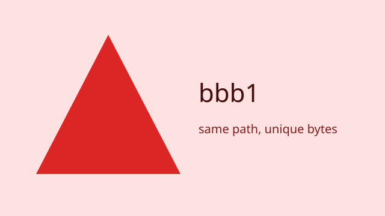
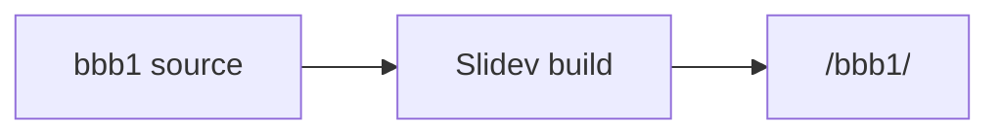

# BBB1 — bundle baseline

Independent Slidev fixture

---
layout: two-cols
title: Same paths, independent content
---

### Relative image



<div class="fixture-conflict">bbb1 scoped style</div>

::right::
### Deck content

- Deck bbb1
- Same relative image path, different file bytes
- First reveal and second reveal

<div v-click>First click step</div>
<div v-click>Second click step</div>

<style scoped>
.fixture-conflict {
  --fixture-conflict-color: #dc2626;
  padding: 0.65rem 0.9rem;
  border-left: 0.35rem solid var(--fixture-conflict-color);
  color: white;
  background: #dc2626;
}
</style>

<!--
PRIVATE_NOTE_bbb1: Keep this note in the private fixture source only.
-->

---
layout: default
title: Code, math, and diagram
---

# Code, math, and diagram

$$
E_{bbb1} = mc^2
$$

```ts {1-3}
const deck = 'bbb1'
const runtime = 'Slidev 53.0.0'
console.log(`${deck}: ${runtime}`)
```



<!--
PRIVATE_NOTE_bbb1: Verify equation and highlighted code on page 3.
-->
