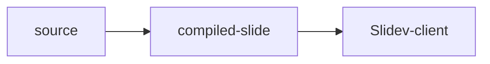

# Shared runtime seed

The static runtime is built once. Uploaded decks provide compiled slide modules.

<div v-click>Click directives stay in the Slidev client.</div>

$$
x^2 + y^2 = z^2
$$

```ts
const runtime = 'Slidev 53'
```


